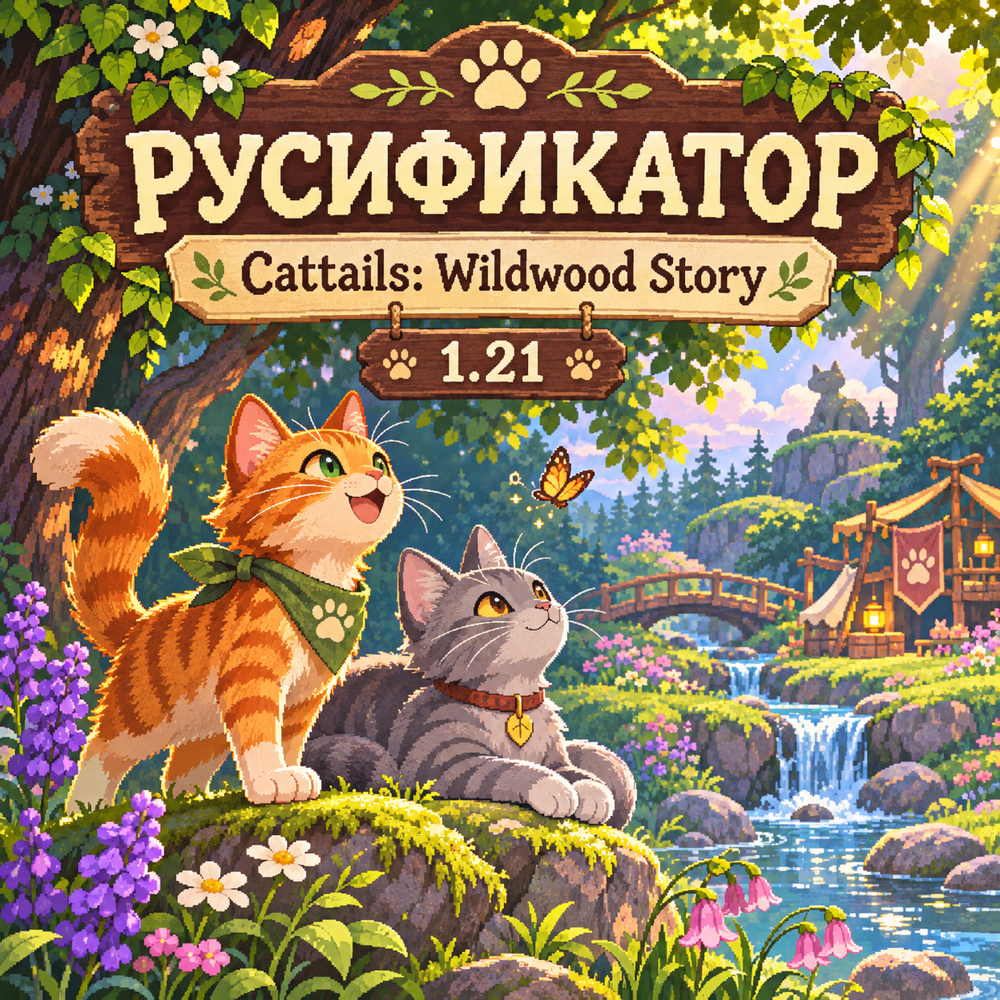

# Cattails: Wildwood Story — русский перевод

Фанатская русская локализация для **Cattails: Wildwood Story 1.21** на ПК. Версия перевода — **v0.1.0**.

[Скачать русификатор](https://github.com/ElecTriKusX/cattails-wildwood-story-ru/releases/download/v0.1.0/cattails_russian.zip) · [Страница релиза](https://github.com/ElecTriKusX/cattails-wildwood-story-ru/releases/tag/v0.1.0)

## Скачать и установить на Windows

1. Скачайте [cattails_russian.zip](https://github.com/ElecTriKusX/cattails-wildwood-story-ru/releases/download/v0.1.0/cattails_russian.zip).
2. Закройте игру. Нажмите **Win + R**, введите `%LOCALAPPDATA%\Cattails_Wildwood_Story` и нажмите **Enter**.
3. Создайте папку `mods`, если её ещё нет. Из архива перенесите папку `cattails_russian` внутрь `mods`. Проверьте, что файл лежит по пути `mods\cattails_russian\languages\russian.lang`.
4. Если используете другой русификатор, на время проверки вынесите его папку из `mods`. Запустите игру и выберите **Languages → Русский**.

## Что уже полностью переведено

В перечисленных разделах переведены пользовательские строки из комплекта файлов версии 1.21.

- **Интерфейс и управление.** Главное меню, настройки, выбор языка, создание персонажа и колонии, инвентарь, хранилище, коллекции и пожертвования.
- **Колония и занятия.** Доска заданий, тексты 67 заданий, сад, музей, патрули, названия построек и варианты планировки колонии.
- **Предметы и мир.** Названия и описания 398 предметов и 194 элементов обстановки, названия локаций и объектов мира, праздники и места для свадьбы.
- **События.** 30 файлов сцен с персонажами, включая реплики и варианты ответа в этих сценах.

## Что ещё вычитывается

В перевод вошли сюжетные тексты, диалоги 44 персонажей и 103 файла писем. Среди сюжетных персонажей отдельно вычитаны Хранительница Леса и Лесной Чемпион. В релизе остаются 1 888 черновых строк в диалогах и 14 в письмах. Они доступны на русском, но ещё требуют литературной вычитки. Полное прохождение сюжета с этой сборкой пока не проверено.

## Особенности перевода

- **Грамматический род.** В английском оригинале для персонажей используются нейтральные формы. В русском тексте, унаследованном от фанатской беты, некоторые персонажи получили грамматический род. В репликах с именем или титулом игрока возможны ошибки согласования.
- **Экранная клавиатура.** Для языка задана кириллическая раскладка. Порядок букв при вводе имени может отличаться от привычного.
- **Шрифт.** По текущим наблюдениям кириллица читается нормально. Если в вашей игре отдельные буквы отображаются плохо, попробуйте включить «Альтернативный шрифт» в настройках.

## Сообщить об ошибке

Откройте [Issues](../../issues) и укажите версию игры, версию русификатора, место или имя персонажа и текст проблемной строки. Скриншот поможет найти реплику. Сюжетные спойлеры лучше убрать под раскрывающийся блок.

## Благодарности

В сборке использованы тексты и значок языка из фанатской русской беты. Авторы беты: szczur_mysz, Nubezumie, RedFox, LaryOne, darrey, Rakel Eneliss и ah.satan. [Обсуждение оригинального перевода](https://vk.ru/topic-147675230_65726393).

Cattails: Wildwood Story разработана Falcon Development. Это фанатский проект.

## Файлы перевода

Папка `cattails_russian` содержит файлы мода из релиза v0.1.0. Для работы над переводом редактируйте файлы `.lang` в этой папке. Для выпуска архива поместите папку `cattails_russian` в корень ZIP-архива и приложите его к новому релизу.
